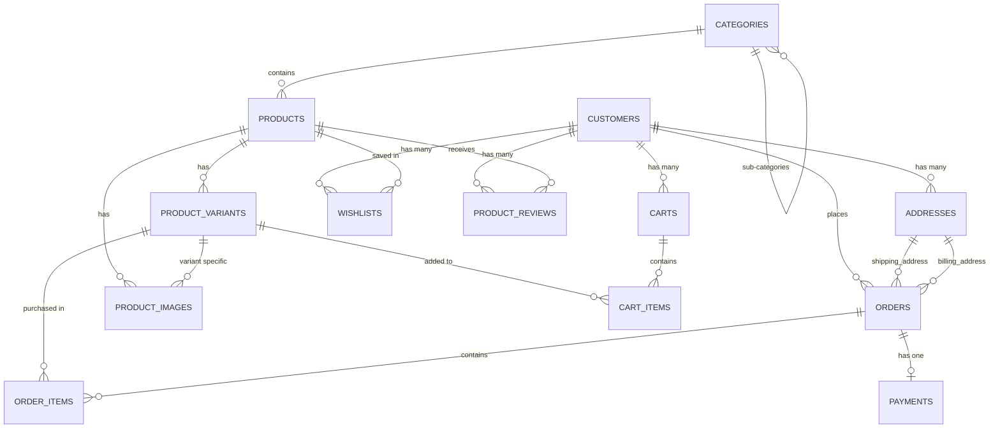

# E-Commerce Database & Architecture Reference (A to Z)

This document provides a comprehensive blueprint of the 4 architectural pillars, database schema, Eloquent models, relationships, controllers, form requests, and route configuration in **Akkustyal**.

---

## 1. Architectural Overview & Entity Relationships



---

## 2. Pillar 1: Users & Authentication

### Tables & Migrations

#### `customers`
- **Primary Auth Table** for customers using the `customer` guard.
- Uses `password_hash` column with Laravel's `getAuthPasswordName()` override.
- **Columns**: `id`, `email`, `password_hash`, `first_name`, `last_name`, `phone`, `is_active`, `timestamps`.

#### `addresses`
- Supports both `shipping` and `billing` addresses with PostgreSQL `CHECK` constraint.
- **Columns**: `id`, `customer_id` (FK -> `customers`), `address_type` (`shipping` | `billing`), `is_default` (bool), `street_line1`, `street_line2`, `city`, `state`, `postal_code`, `country`, `timestamps`.
- **Indexes**: `idx_addresses_customer_id`.

### Model: [Customer.php](file:///e:/laravel/websites/akkustyal/app/Models/Customer.php)
- **Relationships**:
  - `addresses()`: `HasMany<Address>`
  - `carts()`: `HasMany<Cart>`
  - `wishlist()`: `HasMany<Wishlist>`
  - `reviews()`: `HasMany<ProductReview>`
  - `orders()`: `HasMany<Order>`
- **Accessors**: `$customer->full_name`

### Model: [Address.php](file:///e:/laravel/websites/akkustyal/app/Models/Address.php)
- **Relationships**:
  - `customer()`: `BelongsTo<Customer>`
  - `shippingOrders()`: `HasMany<Order>`
  - `billingOrders()`: `HasMany<Order>`
- **Scopes**: `scopeDefault()`, `scopeShipping()`, `scopeBilling()`
- **Accessors**: `$address->full_address`

---

## 3. Pillar 2: Product Catalog & Inventory

### Tables & Migrations

#### `categories`
- Self-referencing tree structure (`parent_id`).
- **Columns**: `id`, `parent_id` (FK -> `categories`, nullable, `onDelete('set null')`), `name`, `slug` (unique), `description`, `timestamps`.
- **Indexes**: `idx_categories_parent_id`, `idx_categories_slug`.

#### `products`
- Core catalog entity.
- **Columns**: `id`, `category_id` (FK -> `categories`, `onDelete('restrict')`), `name`, `slug` (unique), `description`, `is_active`, `timestamps`.
- **Indexes**: `idx_products_category_id`, `idx_products_slug`.

#### `product_variants`
- Holds SKUs, pricing, stock levels, and polymorphic attributes (`size`, `color`, etc.) via JSONB.
- **Columns**: `id`, `product_id` (FK -> `products`, `onDelete('cascade')`), `sku` (unique), `price` (decimal 10,2), `compare_at_price` (decimal 10,2), `stock_quantity` (int), `attributes` (jsonb), `timestamps`.
- **Constraints**: `price >= 0.00`, `compare_at_price >= 0.00`, `stock_quantity >= 0`.
- **Indexes**: `idx_product_variants_product_id`, `idx_product_variants_sku`.

#### `product_images`
- Multiple images per product or linked to specific variants.
- **Columns**: `id`, `product_id` (FK -> `products`), `variant_id` (FK -> `product_variants`, nullable), `image_url` (text), `sort_order` (int), `created_at`.
- **Indexes**: `idx_product_images_product_id`.

### Models:
- [Category.php](file:///e:/laravel/websites/akkustyal/app/Models/Category.php) (`parent()`, `children()`, `products()`, `scopeRoots()`)
- [Product.php](file:///e:/laravel/websites/akkustyal/app/Models/Product.php) (`category()`, `variants()`, `images()`, `reviews()`, `wishlists()`, `scopeActive()`, `$product->primary_image`, `$product->min_price`)
- [ProductVariant.php](file:///e:/laravel/websites/akkustyal/app/Models/ProductVariant.php) (`product()`, `images()`, `cartItems()`, `orderItems()`, `scopeInStock()`, `$variant->is_in_stock`, `$variant->discount_percentage`)
- [ProductImage.php](file:///e:/laravel/websites/akkustyal/app/Models/ProductImage.php) (`product()`, `variant()`)

---

## 4. Pillar 3: Shopping Cart & Customer Engagement

### Tables & Migrations

#### `carts` & `cart_items`
- Supports authenticated customers and guest sessions (`session_id`).
- Unique constraint on `(cart_id, variant_id)` prevents duplicate variant entries.
- **Indexes**: `idx_carts_customer_id`, `idx_carts_session_id`, `idx_cart_items_cart_id`.

#### `product_reviews`
- 1-to-5 star ratings with verified purchase verification.
- Unique constraint: `(customer_id, product_id)` ensures 1 review per product per customer.
- **Indexes**: `idx_product_reviews_product_id`.

#### `wishlists`
- Customer favourites tracker. Unique on `(customer_id, product_id)`.

### Models:
- [Cart.php](file:///e:/laravel/websites/akkustyal/app/Models/Cart.php) (`customer()`, `items()`, `$cart->total_quantity`, `$cart->total_price`)
- [CartItem.php](file:///e:/laravel/websites/akkustyal/app/Models/CartItem.php) (`cart()`, `variant()`, `$item->line_total`)
- [ProductReview.php](file:///e:/laravel/websites/akkustyal/app/Models/ProductReview.php) (`product()`, `customer()`, `scopeVerified()`)
- [Wishlist.php](file:///e:/laravel/websites/akkustyal/app/Models/Wishlist.php) (`customer()`, `product()`)

---

## 5. Pillar 4: Orders & Checkout Management

### Tables & Migrations

#### `orders`
- Status lifecycle: `pending` -> `processing` -> `shipped` -> `delivered` / `cancelled`.
- References immutable snapshot of shipping and billing addresses.
- **Columns**: `id`, `customer_id`, `status`, `total_amount`, `shipping_address_id`, `billing_address_id`, `timestamps`.
- **Indexes**: `idx_orders_customer_id`, `idx_orders_status`.

#### `order_items`
- Line items snapshot with `price_at_purchase` locking in historical prices.
- **Columns**: `id`, `order_id`, `variant_id` (nullable on delete), `quantity`, `price_at_purchase`, `created_at`.
- **Indexes**: `idx_order_items_order_id`.

#### `payments`
- Payment gateway transactions (`stripe`, `paypal`, etc.).
- **Columns**: `id`, `order_id`, `payment_provider`, `transaction_id` (unique), `amount`, `status`, `payment_method`, `timestamps`.
- **Indexes**: `idx_payments_order_id`, `idx_payments_transaction_id`.

### Models:
- [Order.php](file:///e:/laravel/websites/akkustyal/app/Models/Order.php) (`customer()`, `shippingAddress()`, `billingAddress()`, `items()`, `payment()`, `scopePending()`, `scopeDelivered()`, `scopeByStatus()`)
- [OrderItem.php](file:///e:/laravel/websites/akkustyal/app/Models/OrderItem.php) (`order()`, `variant()`, `$item->line_total`)
- [Payment.php](file:///e:/laravel/websites/akkustyal/app/Models/Payment.php) (`order()`, `scopeCompleted()`, `scopeFailed()`)

---

## 6. Controllers & Form Requests

| Controller | Actions | Related Form Request |
|---|---|---|
| [ProductController](file:///e:/laravel/websites/akkustyal/app/Http/Controllers/ProductController.php) | `index(Request)` (filters by category/search)<br>`show(slug)` (loads variants, images, reviews, related) | Standard `Request` |
| [CartController](file:///e:/laravel/websites/akkustyal/app/Http/Controllers/Customer/CartController.php) | `index()`, `store(StoreCartItemRequest)`, `destroy($id)` | [StoreCartItemRequest](file:///e:/laravel/websites/akkustyal/app/Http/Requests/StoreCartItemRequest.php) |
| [FavouriteController](file:///e:/laravel/websites/akkustyal/app/Http/Controllers/Customer/FavouriteController.php) | `index()`, `store(Request)`, `destroy($id)` | Standard `Request` |
| [AddressController](file:///e:/laravel/websites/akkustyal/app/Http/Controllers/Customer/AddressController.php) | `index()`, `store(StoreAddressRequest)`, `destroy(Address)` | [StoreAddressRequest](file:///e:/laravel/websites/akkustyal/app/Http/Requests/StoreAddressRequest.php) |
| [OrderController](file:///e:/laravel/websites/akkustyal/app/Http/Controllers/Customer/OrderController.php) | `index()`, `show(Order)`, `store(StoreOrderRequest)` *(executes DB transaction & decrements stock)* | [StoreOrderRequest](file:///e:/laravel/websites/akkustyal/app/Http/Requests/StoreOrderRequest.php) |
| [ReviewController](file:///e:/laravel/websites/akkustyal/app/Http/Controllers/Customer/ReviewController.php) | `store(StoreReviewRequest)`, `destroy(ProductReview)` | [StoreReviewRequest](file:///e:/laravel/websites/akkustyal/app/Http/Requests/StoreReviewRequest.php) |

---

## 7. Web Route Map

```
// Public
GET     /products                   pages.products.view      ProductController@index
GET     /products/{slug}            pages.products.show      ProductController@show

// Customer Authenticated (middleware: auth:customer)
GET     /favorites                  pages.fav.index          FavouriteController@index
POST    /favorites                  pages.fav.store          FavouriteController@store
DELETE  /favorites/{id}             pages.fav.destroy        FavouriteController@destroy

GET     /cart                       pages.cart.index         CartController@index
POST    /cart                       pages.cart.store         CartController@store
DELETE  /cart/{id}                  pages.cart.destroy       CartController@destroy

GET     /account/addresses          customer.addresses.index AddressController@index
POST    /account/addresses          customer.addresses.store AddressController@store
DELETE  /account/addresses/{addr}   customer.addresses.destroy AddressController@destroy

GET     /account/orders             customer.orders.index    OrderController@index
POST    /account/orders             customer.orders.store    OrderController@store
GET     /account/orders/{order}     customer.orders.show     OrderController@show

POST    /reviews                    customer.reviews.store   ReviewController@store
DELETE  /reviews/{review}           customer.reviews.destroy ReviewController@destroy
```

---

## 8. Database Seeding & Factories

All models have corresponding Pest/PHPUnit factories ready for testing and database seeding:

- `Customer::factory()->create()`
- `Category::factory()->childOf($parentId)->create()`
- `Product::factory()->has(ProductVariant::factory()->count(3))->create()`
- `Address::factory()->shipping()->asDefault()->create()`
- `Order::factory()->pending()->create()`
